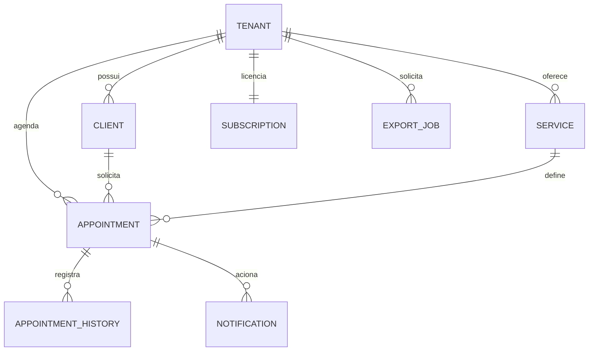
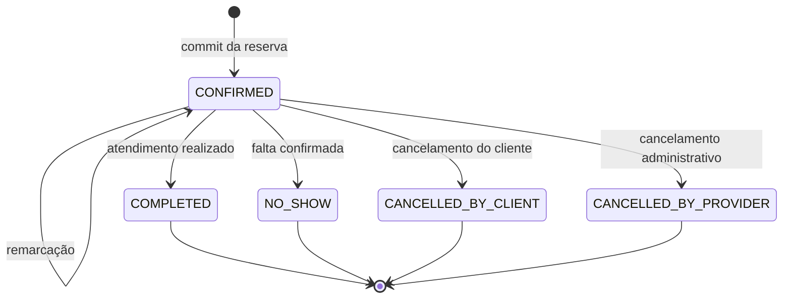
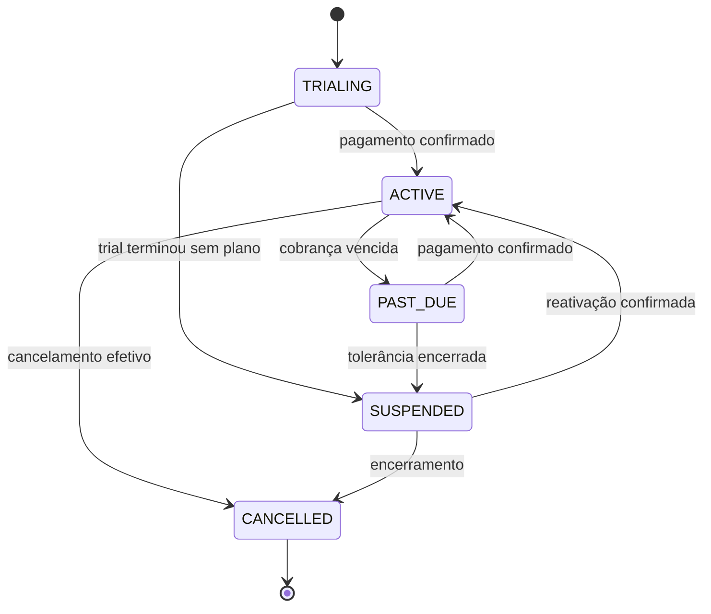
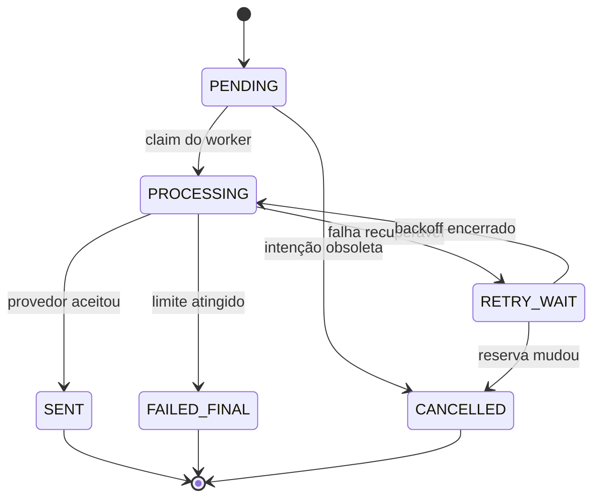
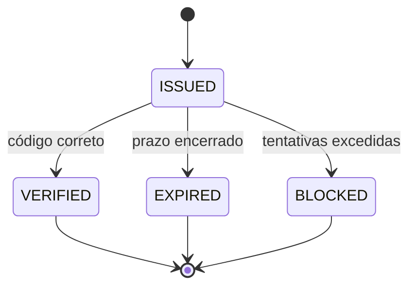
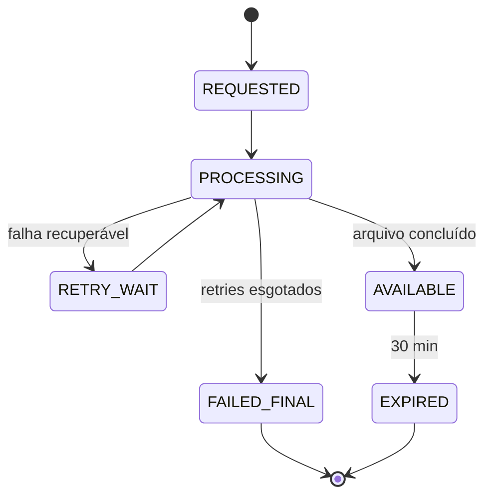

# 02 — Modelo de domínio, estados e invariantes

## 1. Princípios de modelagem

1. O banco é a autoridade para reservas e configurações do tenant.
2. Disponibilidade é derivada; slots não são pré-criados como verdade permanente.
3. Toda mutação importante é transacional, versionada e auditável.
4. Estado de negócio e estado de processamento são separados.
5. Integrações externas não participam da transação local; são acionadas por outbox.
6. Nenhum identificador vindo do cliente substitui o contexto autenticado de tenant.
7. História relevante é append-only; correções geram novos eventos, não edições silenciosas.

## 2. Agregados e entidades

| Agregado/entidade | Responsabilidade | Campos essenciais |
|---|---|---|
| `Tenant` | empresa e isolamento | `tenant_id`, nome, slug, timezone, status, created_at, version |
| `AdminUser` | acesso administrativo | `user_id`, `tenant_id`, identity_ref, role, status |
| `Service` | oferta agendável | `service_id`, tenant, nome, duração, buffer, preço informativo, status, version |
| `AvailabilityPolicy` | regras de janela | tenant, slot_step, min_notice, booking_horizon, cancellation_cutoff, reminder_offset, version |
| `WeeklyPeriod` | grade recorrente | tenant, weekday, local_start, local_end |
| `ScheduleException` | substituição de uma data | tenant, local_date, kind, períodos, motivo, version |
| `BlockedPeriod` | indisponibilidade explícita | block_id, tenant, starts_at, ends_at, motivo, status, version |
| `Client` | identidade local do cliente | client_id, tenant, normalized_phone, display_name, status, version |
| `ClientRestriction` | bloqueio de autoagendamento | restriction_id, client, tipo, motivo, active_from, active_until, lifted_at |
| `Appointment` | reserva e ocupação | appointment_id, tenant, client, service, starts_at, service_ends_at, occupied_until, status, snapshots, version |
| `AppointmentHistory` | transições e remarcações | event_id, appointment, from_status, to_status, before/after, actor, reason, occurred_at |

Na criação administrativa (AGD-021), a história inicial identifica `ADMIN/TENANT_ADMIN` e registra um código de origem. Motivo textual do encaixe é preservado na história de domínio para explicar a decisão, não no evento de auditoria nem na outbox. Auditoria registra somente overrides permitidos, presença de motivo e estado da integração de restrições. AGD-033 substitui `NOT_TRACKED` por consulta persistida tenant-scoped; esse estado legado permanece somente para compatibilidade de auditoria histórica.

Na reserva administrativa, `OUTSIDE_WEEKLY_SCHEDULE` contorna somente a grade semanal quando não há exceção para a data. Uma exceção `CLOSED` continua sem atendimento; uma `SPECIAL` é a lista final de períodos e não pode ser ultrapassada pelo override: serviço mais buffer devem caber integralmente em um único período especial. `MIN_NOTICE` é uma exceção independente e pode ser autorizada dentro de `SPECIAL`, desde que o início continue dentro de um período especial. Bloqueios, ocupações, sobreposição, horizonte, serviço inativo e configuração ausente não são ignoráveis. O comando não altera a grade nem a exceção.

**Decisão de produto aprovada em 17/10/2026 (ADR-0017):** para uma nova remarcação administrativa, o serviço associado precisa estar atualmente `ACTIVE` no tenant. Essa consulta de elegibilidade é separada do snapshot persistido: inativação não cancela reserva nem libera ocupação, e o novo intervalo continua usando duração e buffer originais. Nome e demais snapshots não são atualizados pelo catálogo. Nenhum override ignora serviço inativo. Replay de uma remarcação já confirmada retorna seu receipt original após autorização atual, ainda que o serviço tenha sido inativado posteriormente.
| `AccessChallenge` | código de acesso | challenge_id, tenant, phone_hash/ref, code_hash, expires_at, attempts, status |
| `Notification` | intenção de comunicação | notification_id, tenant, type, target_ref, appointment_version, status, dedupe_key, attempts |
| `Subscription` | direito de uso do tenant | subscription_id, tenant, plan, status, trial_end, period_end, grace_end, version |
| `BillingEvent` | fato vindo do provedor | provider_event_id, tenant, type, payload_digest, verified_at, processing_status |
| `PaymentAttempt` | tentativa de cobrança | attempt_id, subscription, due_date, sequence, provider_ref, status |
| `ExportJob` | snapshot e geração | export_id, tenant, criteria, snapshot_ref, status, object_ref, expires_at, version |
| `IdempotencyRecord` | deduplicação de comando | tenant, scope, key, request_digest, operation_id, state, response_ref, expires_at |
| `OutboxEvent` | publicação pós-commit | outbox_id, tenant, aggregate, type, payload, occurred_at, publish_status |
| `AuditEvent` | trilha de segurança | audit_id, tenant, actor, action, target, outcome, diff_digest/details, occurred_at |

## 3. Relacionamentos principais



Os relacionamentos com provedores externos usam referências opacas. Payload bruto só é retido quando necessário e permitido; o padrão é armazenar digest, campos normalizados e localização segura do original.

## 4. Invariantes do núcleo

### 4.1 Tenant

- `slug` público é globalmente único enquanto reservado.
- Registro de um tenant não referencia entidade de negócio de outro tenant.
- Tenant suspenso não cria novas reservas públicas.
- Reativação não cria um novo tenant nem muda seus identificadores.

### 4.2 Serviço

- `duration_minutes > 0` e múltiplo de 15.
- `buffer_after_minutes >= 0` e múltiplo de 15.
- Serviço inativo não participa de nova disponibilidade.
- Snapshot da reserva não é alterado por mudança posterior no catálogo.
- A criação inicial persiste `CONFIRMED` com versão `1`, snapshot de nome/duração/buffer do serviço, zona IANA usada, instantes `starts_at`, `service_ends_at` e `occupied_until`, e snapshot do nome informado pelo cliente. Preço/moeda só entram no snapshot se o produto/catalog os definir; ausência não significa zero ou moeda implícita.
- A primeira história registra a confirmação de origem pública sem usar telefone como ator autenticado. Telefone e nome não entram em auditoria ou outbox.

### 4.3 Intervalos

- Todos os intervalos usam semântica semiaberta `[início, fim)`.
- Na grade semanal recorrente, limites são horários locais alinhados a múltiplos de 15 minutos; o slot de disponibilidade não altera essa regra. `local_start < local_end`; não há período atravessando meia-noite no MVP. Períodos adjacentes são válidos e períodos sobrepostos são inválidos.
- `starts_at < service_ends_at <= occupied_until`.
- `occupied_until = service_ends_at + buffer_after` no momento da confirmação.
- Dois intervalos podem se tocar no limite: `[09:00, 10:00)` e `[10:00, 11:00)` não se sobrepõem.
- Apenas reservas em estado ocupante entram na restrição; no MVP, `CONFIRMED`.

### 4.4 Exceções e bloqueios administrativos

- Não existir `ScheduleException` para tenant/data significa aplicar a grade semanal. `CLOSED` representa data sem atendimento; `SPECIAL` substitui a grade pela lista final de períodos, incluindo somente períodos que o administrador deseja manter ou adicionar. Remover o registro volta a aplicar a grade semanal.
- Uma exceção é única por `(tenant_id, local_date)`, tem versão CAS e não atravessa meia-noite. Seus períodos são locais, `[start,end)`, limites em múltiplos de 15 minutos, início menor que fim, adjacência válida e sobreposição proibida por constraint PostgreSQL.
- `SPECIAL` exige ao menos um período; `CLOSED` não contém períodos. Motivo da exceção é opcional e não participa de auditoria/outbox.
- Cada limite local de horário especial precisa resolver para exatamente um instante na zona IANA do tenant. Horário inexistente é rejeitado; horário ambíguo exige offset explícito que pertença aos offsets válidos da zona para aquela data/hora. Os offsets selecionados são persistidos junto dos horários locais da exceção; a migração não altera períodos já existentes.
- Bloqueio tem `starts_at < ends_at` em `timestamptz`, sem limite de mesma data; persiste `time_zone` usada na interpretação e os dois instantes UTC. Limites na representação local são alinhados a 15 minutos.
- Motivo da criação é obrigatório. Cancelamento lógico exige novo motivo, mantém motivo original, `block_id`, instante de cancelamento e incrementa a versão CAS. Não há exclusão física nem restrição de não sobreposição entre bloqueios.
- Criação de bloqueio consulta reservas confirmadas após adquirir o mesmo lock transacional de tenant usado pelo commit de reserva. AGD-015 implementa a fonte PostgreSQL de ocupações e o protocolo compartilhado; adapters de teste não substituem a integração persistida.
- Mudança de exceção/bloqueio grava auditoria e `ScheduleChanged` na mesma transação. Payloads e detalhes de auditoria usam allowlist e não incluem motivos livres. A invalidação de cache real depende da implementação de disponibilidade em AGD-013.

### 4.5 Reserva

- Uma reserva confirmada referencia tenant, cliente e serviço existentes no mesmo tenant.
- O intervalo escolhido é revalidado no commit.
- Uma transação concorrente não consegue confirmar intervalo conflitante.
- Remarcação troca o intervalo inteiro ou não troca nada.
- Cancelamento e encerramento são idempotentes quando repetidos com o mesmo comando.
- Uma transição inválida não é corrigida por `UPDATE` genérico.

### 4.6 Cliente e falta

- Telefone normalizado é único por tenant entre clientes ativos, com política explícita para mesclagem.
- Uma falta corresponde a uma transição confirmada de uma reserva.
- AGD-032 conta fatos originais `NO_SHOW` pelo instante de `occurred_at`, uma única vez por história e tenant; cancelamentos e conclusões não contam. Fato compensatório que referencia a falta corrige sua contribuição sem apagar a história inicial.
- Restrição de autoagendamento não apaga faltas e não impede acesso/cancelamento.

**Decisões de produto aprovadas em AGD-032:** cada avaliação captura uma única referência `asOf` com `Clock`; `windowStart` é `asOf` menos 12 meses de calendário UTC, preservando hora e ajustando datas inválidas ao último dia válido (ex.: 29/02 → 28/02), com intervalo `[windowStart, asOf)`. O timezone do tenant não participa do cálculo. A correção administrativa é exclusivamente `NO_SHOW → COMPLETED`, com motivo, CAS e idempotência; a história original permanece e uma história compensatória aponta para ela. A falta corrigida não contribui para a contagem. Política ausente é `NOT_CONFIGURED`, sem default e sem inferir `CLEAR` ou bloqueio. O status da restrição é separado: `NOT_CONFIGURED`, `CLEAR` ou `RESTRICTED`.

**Decisões adicionais aprovadas pelo usuário em 20/10/2026 (ADR-0024):** correção e envelhecimento não liberam restrição ativa; somente desbloqueio administrativo explícito com motivo, CAS e idempotência. Política ausente/removida não altera restrições existentes nem autoriza nova ativação por limite. Sem política e sem restrição ativa, reserva pública permanece permitida como `NOT_CONFIGURED`, sujeita aos demais gates. Redução de limite só é aplicada retroativamente por reconciliação administrativa explícita e recuperável, depois do PUT. A reconciliação usa a versão esperada da política e não pode reutilizar uma falta já consumida como causa, mesmo após desbloqueio; nova falta é nova causa.
- Desbloqueio manual registra autor e motivo.

### 4.7 Assinatura

- Um tenant possui uma assinatura corrente.
- Trial não é concedido novamente por simples cancelamento/recriação.
- Transições financeiras dependem de fato autenticado ou consulta autoritativa ao provedor.
- Evento do provedor é processado no máximo uma vez do ponto de vista lógico.

AGD-043 reutiliza o ciclo/attempt de inadimplência da assinatura; pagamento confirmado por evento autenticado correlacionado ao attempt atualiza `ACTIVE`, encerra o ciclo e cancela apenas tentativas ainda não iniciadas na mesma transação. Cada attempt conserva snapshot imutável de valor, moeda e versões de oferta/termos; mudança posterior do contrato corrente não reinterpreta evento ou retry já associado ao attempt. A referência de pagamento, provider/account e termos devem coincidir com dados persistidos no servidor. `paidThroughAt` é recebido da autoridade financeira; o domínio não deduz a duração de mês/ano nem reinterpreta o instante por timezone local. Período mais antigo não substitui um período persistido mais recente. Mandato mensal e autorização anual por período são portas distintas, ambas fail-closed sem configuração confiável. A intenção de aviso anual tem identidade por tenant, assinatura e período; mudança do período/versão a obsoleta, sem alegar envio.

### 4.8 Exportação

- Critérios e snapshot não mudam depois do início.
- No máximo um job ativo por tenant.
- Arquivo expirado não volta a `AVAILABLE`.
- Download nunca ignora autorização atual ou isolamento por tenant.

## 5. Restrição de não sobreposição

A aplicação faz validação amigável, mas a proteção definitiva deve existir no PostgreSQL. Forma conceitual:

```sql
CREATE EXTENSION IF NOT EXISTS btree_gist;

ALTER TABLE appointment
ADD CONSTRAINT appointment_no_overlap
EXCLUDE USING gist (
  tenant_id WITH =,
  tstzrange(starts_at, occupied_until, '[)') WITH &&
)
WHERE (status = 'CONFIRMED');
```

Observações:

- A migração real deve ser testada com o tipo de `tenant_id` escolhido e com a versão de PostgreSQL.
- Se futuramente houver profissionais/recursos, a chave de exclusão passa a incluir `resource_id`; a agenda única usa `tenant_id`.
- Uma violação dessa constraint é traduzida para erro de domínio `SLOT_NO_LONGER_AVAILABLE`.
- Não usar lock distribuído como única proteção; falha ou expiração do lock não pode permitir conflito.

## 6. Máquina de estados da reserva



### Correções

Para AGD-023, decisão de produto aprovada pelo usuário em 17/10/2026 (ADR-0018): `COMPLETED` e `NO_SHOW` somente quando o instante confiável é igual ou posterior a `occupied_until`, incluindo buffer; buffer zero significa `occupied_until = service_ends_at`. O cancelamento do cliente aceita `now` igual ao cutoff configurado. Cancelamento administrativo não usa o cutoff de cliente. Não há tolerância adicional de dez minutos.

Uma correção de estado terminal não deve fingir que a transição original nunca ocorreu. AGD-032 implementa apenas o comando específico `CorrectNoShow` (`NO_SHOW → COMPLETED`), que:

1. valida a autoridade do ator;
2. registra o estado contestado e a justificativa;
3. aplica novo fato compensatório;
4. remove somente a contribuição do fato corrigido da contagem derivada;
5. publica `ClientNoShowCorrected` na outbox.

O comando não retorna a reserva a `CONFIRMED`, não altera snapshots/horários e não libera uma ocupação ativa (a reserva já estava terminal). Outras correções de terminal permanecem fora do escopo.

Dependendo da experiência desejada, o estado corrente pode refletir o resultado corrigido, mas o histórico original permanece.

## 7. Máquina de estados da assinatura



### Regras de transição

| Origem | Evento | Destino | Efeito |
|---|---|---|---|
| `TRIALING` | trial ainda válido | `TRIALING` | acesso normal e aviso progressivo |
| `TRIALING` | pagamento confirmado | `ACTIVE` | inicia período contratado |
| `ACTIVE` | vencimento sem confirmação | `PAST_DUE` | inicia tolerância e retries |
| `PAST_DUE` | pagamento confirmado | `ACTIVE` | encerra retries pendentes |
| `PAST_DUE` | `grace_end` ultrapassado | `SUSPENDED` | fecha novas reservas públicas |
| `SUSPENDED` | pagamento confirmado | `ACTIVE` | restaura operação imediatamente |
| ativo/suspenso | cancelamento efetivo | `CANCELLED` | inicia política de retenção |

`PAST_DUE` é preferível a representar tolerância como booleano, pois torna políticas e métricas explícitas.

Para AGD-042, `grace_ends_at` é vencimento mais 168 horas; D0/D+3/D+6 são offsets UTC de 0/72/144 horas. A atualização a `PAST_DUE` e a suspensão usam CAS sob o lock tenant-scoped também usado por reservas. **Decisão aprovada pelo usuário em 22/10/2026:** a igualdade `now >= grace_ends_at` encerra a tolerância. Em recuperação tardia durante a tolerância, só a tentativa vencida mais recente ainda não iniciada pode permanecer elegível; as anteriores nunca iniciadas são `SKIPPED_LATE_RECOVERY` com motivo, sem deslocar futuras ou criar novas. Tentativas iniciadas, em voo ou desconhecidas não são puladas; devem ser reconciliadas antes de outra cobrança lógica. Após a fronteira não se inicia transporte novo, mas resultado de tentativa já iniciada permanece persistível, mesmo após suspensão. O valor nunca altera o fim do trial.

Para AGD-040, o trial dura 14 dias corridos em instantes UTC (336 horas): é válido somente enquanto `now < trialEndsAt` e expira na igualdade (`now >= trialEndsAt`), transitando para `SUSPENDED`. A tolerância de sete dias pertence exclusivamente a `PAST_DUE`; o worker pode materializar a transição por CAS, mas o gate de novas reservas não aguarda o worker. A fonte de identidade comercial verificável segue pendente; sem fonte configurada ou resultado conclusivo não existe trial ativo.

## 8. Máquina de estados de notificação



O estado `SENT` significa que o provedor aceitou a mensagem, não necessariamente que o destinatário a leu. Se o provedor expuser entrega/leitura, registrar como eventos adicionais sem reabrir a intenção.

Antes de enviar lembrete, o worker compara `appointment_version` e estado corrente. Divergência torna a intenção obsoleta.

AGD-031 persiste uma intenção lógica `APPOINTMENT_REMINDER` por tenant, reserva, versão e destinatário. `due_at` preserva o instante UTC original calculado a partir do início e do offset explicitamente configurado quando o evento é consumido; `next_attempt_at` pode avançar por backoff sem alterar `due_at`. Política ausente não cria intenção. Um job atrasado pode prosseguir somente se a reserva continua `CONFIRMED`, na mesma versão e com `starts_at` estritamente posterior ao instante do preflight; igualdade ou início passado obsoleta a intenção, sem tolerância. Reserva criada após `due_at` pode ser processada imediatamente se ainda futura. Alteração posterior da política não recalcula intenções materializadas; eventos ainda não consumidos e versões novas usam a política vigente no consumo. Remarcação invalida versões anteriores; cancelamento, conclusão e falta invalidam lembretes inelegíveis, preservando o resultado de qualquer transporte já iniciado conforme ADR-0021.

## 9. Máquina de estados do código de acesso



- Desafio verificado não pode ser reutilizado.
- Novo envio invalida ou supersede desafios anteriores conforme política única e documentada.
- Contadores de rate limit são separados do desafio para sobreviver a reenvios.

## 10. Máquina de estados da exportação



- `AVAILABLE` só é confirmado após o objeto existir, ter digest e metadados persistidos.
- Expiração lógica ocorre mesmo se a remoção física do objeto atrasar; o objeto não pode ser servido.
- Job preso em `PROCESSING` deve ter lease e recuperação segura.

## 11. Idempotência de comandos

### Registro

Chave lógica recomendada:

`(tenant_id, command_scope, idempotency_key)`

Campos:

- `operation_id` gerado pelo servidor;
- digest canônico do método, rota, versão do contrato e corpo relevante;
- estado `IN_PROGRESS`, `COMPLETED`, `FAILED_DETERMINISTIC` ou `OUTCOME_UNKNOWN`;
- referência segura da resposta;
- timestamps, lease de processamento e expiração.

### Algoritmo

1. Normalizar e calcular digest do comando.
2. Inserir o registro com unicidade; se já existir, bloquear/ler o existente.
3. Se o digest divergir, rejeitar com `IDEMPOTENCY_KEY_REUSED`.
4. Se `COMPLETED`, devolver resultado original.
5. Se `FAILED_DETERMINISTIC`, devolver o mesmo erro estável enquanto o registro for válido.
6. Se `IN_PROGRESS`, aguardar por período curto ou retornar `OPERATION_IN_PROGRESS` com consulta por `operation_id`.
7. Se `OUTCOME_UNKNOWN`, não repetir automaticamente; reconciliar.

Para a transação local de reserva, o idempotency record e a reserva devem ser confirmados na mesma transação sempre que possível.

### Retenção

Retenção deve exceder o maior período plausível de retry do cliente ou integração. Para reservas, proposta inicial: 24 horas; para webhooks financeiros, guardar o identificador do evento pelo período contratual/auditável necessário. Expiração não permite reutilizar uma chave permanentemente vinculada quando a operação externa ainda puder reaparecer; nesse caso, preservar ao menos o tombstone do vínculo.

## 12. Disponibilidade derivada

### Por que não persistir slots como autoridade

Slots pré-gerados ficam obsoletos quando grade, exceção, serviço, bloqueio, fuso ou reserva muda. O desenho recomendado:

1. gerar candidatos pela grade e `slot_step`;
2. aplicar exceção da data;
3. cortar candidatos cuja ocupação completa não cabe;
4. remover bloqueios e reservas sobrepostos;
5. aplicar antecedência e horizonte usando relógio do servidor;
6. devolver resultados com uma `availability_version` apenas para diagnóstico/cache;
7. revalidar tudo no commit, sem confiar na versão exibida.

Cache pode acelerar a consulta, mas deve ser invalidável e nunca substituir a constraint de banco.

Na consulta AGD-013, capturar o instante do servidor uma vez. Inícios avançam a partir do começo de cada período aplicável, inclusive períodos `SPECIAL`, e filtros de bloqueio/ocupação/antecedência não movem a âncora. `from` e `to` são datas locais inclusivas, com janela máxima de 31 datas (`DAYS.between + 1`). O horizonte de N dias inclui a data local de hoje e a última data hoje + N - 1, inclusive; não equivale a N vezes 24 horas. A consulta pode retornar datas fora do horizonte, sempre sem slots. Ver contrato detalhado no documento 01 §5.6 e documento 03.

## 13. Concorrência por operação

### Criar reserva

Transação curta:

1. validar idempotência;
2. carregar tenant, serviço, política e cliente/restrição necessários;
3. validar intervalo e regras;
4. inserir reserva `CONFIRMED`;
5. inserir história, auditoria e outbox;
6. concluir idempotency record;
7. commit.

Para criação pública, slug resolve tenant exclusivamente no servidor; replay revalida publicação/readiness e serviço ativo antes de revelar o resultado mínimo. A validação inicial de disponibilidade não reserva o slot. No commit, horário/offset são comparados ao cálculo corrente; ausência de slot é `SLOT_NO_LONGER_AVAILABLE`.

Criação de reserva e criação de bloqueio compartilham lock transacional por tenant antes de consultar conflitos. A reserva também usa exclusion constraint GiST sobre `[starts_at, occupied_until)` para impedir sobreposição entre reservas mesmo sob concorrência. Em `READ COMMITTED`, consultas de conflito feitas após a espera do lock observam o commit precedente; a instrução que espera não reutiliza snapshot anterior à espera. Ver ADR-0014.

Qualquer violação de sobreposição aborta toda a transação.

### Remarcar

1. receber `expected_version` ou `If-Match`;
2. bloquear a reserva ou usar compare-and-set;
3. validar que continua `CONFIRMED` e na versão esperada;
4. validar novo intervalo;
5. atualizar intervalo e incrementar versão;
6. cancelar intents de lembrete antigas e criar nova intenção;
7. registrar história, auditoria e outbox;
8. commit.

Se o novo intervalo conflitar, nenhum campo é alterado.

### Cancelar/encerrar

- Usar compare-and-set de status/versão.
- Repetição idempotente do mesmo comando devolve o resultado já alcançado.
- Comando concorrente diferente recebe `VERSION_CONFLICT` ou `INVALID_STATE_TRANSITION` e deve recarregar.

## 14. Outbox transacional

Reservas, histórico e `OutboxEvent` são gravados na mesma transação. Um publicador separado:

- reivindica registros com `FOR UPDATE SKIP LOCKED` ou mecanismo equivalente;
- publica evento;
- registra tentativa e confirmação;
- pode publicar mais de uma vez em falha ambígua.

Consumidores devem ser idempotentes. O padrão oferece entrega **pelo menos uma vez** sem perder evento após o commit; não promete exatamente uma vez entre sistemas.

## 15. Auditoria e temporalidade

Usar três noções quando forem materialmente diferentes:

- `occurred_at`: quando o fato de negócio ocorreu;
- `recorded_at`: quando a plataforma o registrou;
- `effective_at`: quando uma regra ou decisão passa a valer.

O relógio do banco/servidor é autoridade operacional. Horário informado por cliente ou provedor é evidência, não substituto automático.

## 16. Índices e constraints recomendados

- `tenant(slug)` unique.
- `service(tenant_id, normalized_name)` unique parcial para ativos, se a regra for confirmada.
- `client(tenant_id, normalized_phone)` unique.
- `appointment(tenant_id, starts_at)` para agenda.
- exclusion constraint de ocupação.
- `appointment(client_id, starts_at desc)` para histórico/faltas.
- `notification(status, next_attempt_at)` para worker.
- `outbox_event(publish_status, occurred_at)` para publicador.
- `billing_event(provider, provider_event_id)` unique.
- `idempotency_record(tenant_id, scope, key)` unique.
- `export_job(tenant_id)` unique parcial para estados ativos.
- checks de duração, intervalos e datas.

Todo índice deve ser validado com volume e planos reais; a lista é baseline, não substitui teste de carga.

## 17. Evolução do esquema

- Migrações com Flyway ou Liquibase, uma autoridade por ambiente.
- Alterações destrutivas em duas ou mais etapas: expandir, migrar, trocar leitores, contrair.
- Eventos carregam `schema_version`.
- Campos novos devem ter default seguro ou tolerância a ausência durante rollout.
- Não reutilizar significado de enum existente; adicionar estado e migrar explicitamente.
- Snapshots históricos permanecem interpretáveis após mudança de catálogo.

## 18. Estado desconhecido

`UNKNOWN` pertence ao resultado de uma operação cujo efeito não pode ser provado, especialmente em provedores externos. Não deve ser usado como atalho para um estado de reserva mal definido.

- Se o commit PostgreSQL é recuperável por `operation_id`, consultar a autoridade e concluir `COMPLETED` ou `FAILED_DETERMINISTIC`.
- Se uma cobrança ou mensagem externa pode ter produzido efeito parcial, registrar `OUTCOME_UNKNOWN`, bloquear retry inseguro e reconciliar.
- Os estados parciais e os mecanismos completos de quarentena são definidos no documento 05.
