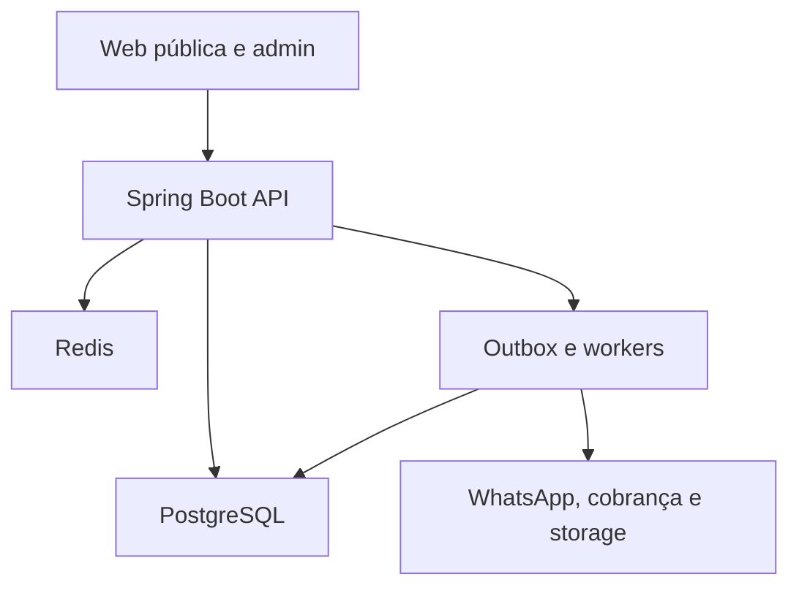
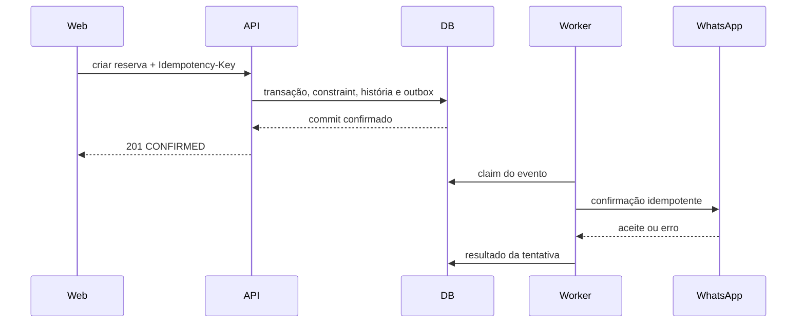

# 04 — Arquitetura e plano de implementação

## 1. Decisão arquitetural

Construir o MVP como **monólito modular**, com frontend web separado, PostgreSQL como autoridade e workers assíncronos no mesmo repositório/backend. Os módulos se comunicam por APIs internas e eventos de domínio; não acessam tabelas uns dos outros de forma indiscriminada.

### Por que esta é a melhor relação custo/risco agora

| Aspecto | Benefício | Trade-off |
|---|---|---|
| Uma implantação de backend | operação, tracing e transações simples | falha de processo pode afetar mais módulos |
| Um PostgreSQL | integridade forte para agenda e relatórios | exige disciplina de ownership de tabelas |
| Eventos internos + outbox | prepara evolução assíncrona sem perder fatos | adiciona worker e idempotência |
| Módulos explícitos | reduz acoplamento e facilita extração futura | requer regras de dependência no CI |
| Sem microserviços no MVP | evita coordenação distribuída prematura | escala independente vem depois |

Microserviços só se justificam quando houver evidência de necessidade: escalas muito diferentes, equipes independentes, isolamento regulatório ou disponibilidade por domínio. Separá-los agora aumentaria justamente os estados `UNKNOWN` e as recuperações complexas descritas no documento 05.

## 2. Stack recomendada

### Backend

- Java 21 LTS.
- Spring Boot 3.x.
- Spring Web MVC para REST.
- Spring Security para autenticação/autorização.
- Bean Validation para validação de borda.
- JPA/Hibernate para CRUD e jOOQ/JdbcTemplate onde consultas de agenda/constraints exigirem controle SQL; escolher um padrão por caso, sem esconder SQL crítico.
- Flyway para migrações.
- PostgreSQL 16+ gerenciado em produção.
- Micrometer + OpenTelemetry para métricas e traces.

### Frontend

- TypeScript + React.
- Next.js é recomendado para página pública rápida, metadados sociais e boa experiência de implantação; React/Vite também atende se SSR não for necessário.
- UI responsiva, priorizando celular no fluxo do cliente.
- Biblioteca de formulários com validação alinhada ao contrato OpenAPI.
- Datas por biblioteca que suporte zona IANA; não depender apenas do fuso do navegador.

### Infraestruturas auxiliares

- Redis para rate limit, sessões curtas/cache e coordenação não autoritativa.
- Storage compatível com S3 para exportações e backups.
- No MVP, fila baseada em tabela PostgreSQL/outbox pode atender.
- Quando throughput/isolamento exigir, adotar RabbitMQ, SQS ou equivalente; Kafka não é necessário para o lançamento.

## 3. Visão de componentes



O commit da reserva termina no PostgreSQL. WhatsApp, analytics e outros efeitos são posteriores; portanto a indisponibilidade deles não corrompe a agenda.

## 4. Módulos de negócio

| Módulo | Ownership | Pode depender de |
|---|---|---|
| `identity-access` | admin, sessão do cliente, papéis | tenant, audit |
| `tenant` | empresa, slug, timezone, onboarding | subscription gate, audit |
| `catalog` | serviços e snapshots | tenant, audit |
| `availability` | grade, exceções, bloqueios e cálculo | tenant, catalog, leitura de appointments |
| `appointments` | reserva, ocupação, história e comandos | tenant, catalog, clients, policy ports |
| `clients` | cliente, faltas e restrições | appointments events, audit |
| `notifications` | intenções, templates e adapter | eventos; leitura mínima de appointment |
| `subscriptions` | trial, planos, cobrança e gate | tenant, billing adapter, audit |
| `exports` | snapshot, geração, objeto e download | read models autorizados, storage |
| `audit` | eventos de auditoria | nenhum módulo de negócio |
| `platform-ops` | outbox, idempotência, jobs, observabilidade | infraestrutura |

### Regra de dependência

- Módulo publica porta/serviço de aplicação e eventos.
- Outro módulo não importa repositório concreto nem entidade JPA interna.
- Consultas compostas usam read model dedicado ou interface explícita.
- Dependências cíclicas são falha de arquitetura no CI, verificadas por ArchUnit.

## 5. Estrutura de código proposta

```text
backend/
  src/main/java/com/appagendamento/
    tenant/
      api/
      application/
      domain/
      infrastructure/
    catalog/
    availability/
    appointments/
    clients/
    notifications/
    subscriptions/
    exports/
    identityaccess/
    audit/
    platform/
  src/main/resources/
    db/migration/
    application.yml
frontend/
  app/
    (public)/
    admin/
    client/
  components/
  lib/api/
  lib/time/
```

Dentro de cada módulo:

- `api`: controllers e DTOs;
- `application`: casos de uso e limites transacionais;
- `domain`: regras, tipos e eventos sem dependência de framework quando prático;
- `infrastructure`: repositórios, adapters e configuração.

Evitar uma pasta global `service/` ou `repository/` que misture domínios.

## 6. Fluxo crítico de criação de reserva



O worker nunca precisa manter a transação de banco aberta durante a chamada externa.

## 7. Limites transacionais

### Na mesma transação

- idempotency record do comando;
- validações que dependem do estado corrente;
- reserva ou transição;
- snapshot/história;
- auditoria essencial;
- outbox.

### Fora da transação

- envio de mensagem;
- chamada ao provedor de cobrança;
- geração/upload de exportação;
- analytics;
- tarefas demoradas.

Uma chamada externa dentro da transação aumentaria locks e ainda não garantiria atomicidade entre sistemas.

## 8. Persistência e tenancy

### Estratégia inicial

- Banco e schema compartilhados.
- `tenant_id NOT NULL` em toda tabela de tenant.
- Chaves únicas incluem `tenant_id` quando a unicidade é local.
- Repositórios administrativos recebem `TenantContext` derivado da autenticação.
- Métodos genéricos `findById(id)` para entidades multi-tenant são proibidos; usar `findByTenantAndId` ou repositório já escopado.
- Testes automatizados tentam cruzar IDs de tenants.

### Row-level security

PostgreSQL RLS pode oferecer defesa adicional, mas exige configurar o tenant por transação e limpar corretamente conexões do pool. Recomenda-se:

1. lançar com escopo obrigatório na aplicação e testes de segurança fortes;
2. prototipar RLS antes de ativá-la;
3. ativar quando o comportamento com jobs, migrações, suporte e pool estiver demonstrado;
4. nunca tratá-la como substituta da autorização de aplicação.

### Particionamento

Não particionar tabelas no MVP sem métricas que justifiquem. Índices por tenant e data atendem o volume inicial. Planejar arquivamento/particionamento apenas quando planos de consulta e tamanho real indicarem.

## 9. Disponibilidade e cache

O cálculo é determinístico sobre configuração e ocupações atuais.

### Cache permitido

- catálogo público;
- configuração publicável;
- resultado de disponibilidade por curto TTL, por tenant/serviço/período;
- tokens de rate limit e sessões.

### Cache não autoritativo

- A reserva não confia no cache para confirmar slot.
- Invalidação ocorre após commit de serviço, agenda, bloqueio ou reserva.
- Perder o Redis reduz desempenho/limites, mas não permite sobreposição.
- Rate limit crítico pode falhar fechado ou usar fallback local/DB de acordo com risco; a decisão é monitorada.

## 10. Segurança

### Administrador

- Preferir provedor OIDC confiável ou implementação madura, não autenticação artesanal.
- MFA recomendado desde o MVP e obrigatório para suporte/operações privilegiadas.
- Sessão curta com renovação segura e revogação.
- Proteção CSRF se autenticação por cookie.
- Política de reautenticação para exportação excepcional e alterações de cobrança.

### Cliente

- Código de uso único, hash, TTL e rate limit.
- Sessão restrita a tenant + telefone e escopo mínimo.
- Cookie `HttpOnly` quando possível.
- Respostas neutras contra enumeração.

### Aplicação e infraestrutura

- TLS, HSTS e headers de segurança.
- CORS restrito aos domínios necessários.
- Queries parametrizadas.
- Validação de upload/tamanho, embora o MVP não precise de upload público.
- Segredos em secret manager do ambiente.
- Credenciais distintas por ambiente e privilégio mínimo.
- Criptografia de storage e backups.
- Dependabot/Renovate ou equivalente, SAST e scan de container no CI.
- Logs com redaction de telefone, tokens e payloads financeiros.

### Dados pessoais

- Telefone pode ter uma representação normalizada para operação e valor cifrado/protegido para exibição.
- Hash sozinho não serve para telefonia; quando usado para busca, empregar HMAC com chave rotacionável, considerando estratégia de rotação.
- Exportações e suporte têm autorização mais forte e auditoria.

## 11. Outbox e workers

### Implementação inicial

- Tabela `outbox_event` no PostgreSQL.
- Worker em instância separável do mesmo artefato, habilitado por profile.
- Claims curtos com `FOR UPDATE SKIP LOCKED`.
- Estado de tentativa, `next_attempt_at`, erro normalizado e limite.
- Dead-letter lógico para falha final.

### Escala horizontal

- Múltiplos workers podem reivindicar itens diferentes.
- Lease expira após crash e permite retomada.
- Consumidor continua idempotente porque publicação externa pode ser ambígua.
- Backpressure limita concorrência por provedor/tenant.

### Migração para broker

Quando necessária, o publicador envia a um broker, mas a outbox continua fechando a lacuna entre commit e publicação. Não fazer dual write direto banco+broker.

## 12. Cobrança e mensageria por adapters

Interfaces internas usam linguagem do domínio e não objetos do SDK do fornecedor.

```text
MessagingPort
  requestAccessCode(...)
  requestAppointmentMessage(...)
  queryDeliveryEvidence(...)

BillingPort
  createCheckout(...)
  requestCharge(...)
  queryCharge(...)
  requestCancellation(...)
```

Cada adapter classifica resultados:

- confirmado com evidência;
- rejeitado sem efeito com evidência;
- falha recuperável antes do efeito;
- resultado ambíguo;
- entrada inválida.

Essa classificação impede retries perigosos e facilita trocar o provedor.

## 13. Exportação

Fluxo recomendado:

1. API valida filtro e exclusividade por tenant.
2. Persiste `ExportJob` e snapshot de critérios.
3. Worker lê dados em páginas consistentes.
4. Gera arquivo em diretório efêmero com limite de espaço.
5. Calcula digest.
6. Faz upload criptografado.
7. Confirma metadados e muda para `AVAILABLE`.
8. Emite token/link curto quando usuário autorizado pedir.
9. Expiração fecha acesso e agenda remoção.

Para datasets grandes, evitar manter uma transação aberta por toda a geração. Use um watermark/checkpoint consistente ou réplica de leitura, documentando a semântica do snapshot.

## 14. Observabilidade

### Logs

- JSON estruturado.
- `trace_id`, `span_id`, `correlation_id`, `operation_id`, `tenant_ref` pseudonimizado, módulo, outcome e duração.
- Não usar número de telefone como chave de log.
- Eventos de segurança separados e protegidos.

### Métricas

| Domínio | Métricas mínimas |
|---|---|
| API | taxa, latência, 4xx/5xx por rota normalizada |
| Agenda | consultas, tentativas, confirmações, conflitos de slot |
| Workers | backlog, idade do item mais antigo, retries, dead letters |
| WhatsApp | solicitações, aceite, entrega disponível, falha por classe |
| Cobrança | pagamentos, falhas, retries, past_due, suspensões, reativações |
| Exportação | duração, tamanho, falhas, expirações |
| Segurança | rate limits, logins falhos, webhooks inválidos, ações privilegiadas |

### Alertas

- backlog ou idade acima do SLO;
- ausência inesperada de processamento;
- aumento sustentado de 5xx;
- conflitos de slot anormais;
- webhook inválido/duplicado em volume atípico;
- falha de backup ou teste de restore;
- divergência de reconciliação financeira;
- storage ou banco próximos do limite.

Alertas precisam de runbook e responsável; alerta sem ação definida vira ruído.

## 15. Implantação

### Ambientes

- `local`: Docker Compose com PostgreSQL, Redis e storage compatível.
- `test`: efêmero por pipeline quando viável.
- `staging`: integrações sandbox, dados sintéticos.
- `production`: rede privada para banco/cache, secrets gerenciados, backups e observabilidade.

### Unidades implantáveis

1. frontend;
2. backend API;
3. worker/scheduler do mesmo build;
4. PostgreSQL;
5. Redis;
6. object storage.

API e worker podem começar no mesmo processo em ambiente pequeno, mas devem ter profiles e métricas separadas para permitir divisão sem refatorar domínio.

### Deploy seguro

- imagem imutável identificada por digest;
- migração compatível antes/ao redor do rollout;
- health checks separados: liveness não depende de toda integração, readiness depende do mínimo para servir com segurança;
- rolling/blue-green conforme plataforma;
- rollback de aplicação não reverte migração destrutiva;
- feature flags versionadas para mudanças de alto impacto;
- smoke test de reserva, idempotência e isolamento após deploy.

## 16. Backup e recuperação

- Backup automatizado do PostgreSQL e retenção definida.
- Point-in-time recovery quando o provedor permitir.
- Exportações não substituem backup.
- Segredos/chaves possuem cópia e rotação controladas.
- Teste de restore periódico em ambiente isolado.
- Antes de liberar um restore, reaplicar ledger/tombstones de exclusão e validar integridade.
- Registrar RPO/RTO observados, não apenas configurados.

O restore isolado nunca é promovido se a fonte de tombstones estiver indisponível ou contestada; ver documento 05.

## 17. Estratégia de testes

### Pirâmide

- unitários para políticas, intervalos, estados e normalização;
- integração com PostgreSQL real via Testcontainers;
- contratos para APIs e webhooks;
- end-to-end dos fluxos públicos e administrativos essenciais;
- carga para disponibilidade e disputa de slot;
- caos direcionado a timeout de provedor, worker crash e webhook fora de ordem;
- restore drill e teste de exclusão.

### Casos que exigem banco real

- exclusion constraint;
- locks/CAS concorrentes;
- `SKIP LOCKED`;
- índices e planos de consulta;
- migrações;
- timezone/timestamps;
- unicidade de idempotência.

H2 ou banco em memória não é substituto válido para esses testes.

### Testes de propriedade úteis

- geração de intervalos nunca oferece slot cuja ocupação ultrapassa a grade;
- intervalos confirmados nunca se sobrepõem;
- repetir comando não aumenta cardinalidade do efeito;
- toda transição aceita pertence à tabela de estados;
- evento antigo não reverte fato financeiro posterior;
- isolamento por tenant permanece sob IDs aleatórios e filtros variados.

## 18. CI/CD e qualidade

Pipeline mínimo:

1. formatação/lint;
2. compilação;
3. unitários;
4. integração/Testcontainers;
5. ArchUnit;
6. validação OpenAPI e migrações;
7. SAST/dependency/container scan;
8. build de imagens por digest;
9. deploy staging;
10. smoke/e2e;
11. promoção com aprovação conforme ambiente.

Branch principal deve permanecer implantável. Mudanças de esquema ou contrato vêm com testes de compatibilidade.

## 19. Sequência de implementação técnica

### Fundação

- repositórios, módulos e regras ArchUnit;
- tenant/contexto, autenticação administrativa e auditoria;
- PostgreSQL/Flyway, observabilidade e pipeline;
- idempotência e outbox genéricas.

### Núcleo

- catálogo;
- grade/política/exceções;
- cálculo de disponibilidade;
- reserva e constraint;
- agenda administrativa.

### Experiência

- link público;
- acesso por WhatsApp;
- notificações e lembrete;
- faltas e bloqueio.

### Comercial e operação

- trial/assinatura/cobrança;
- exportação;
- retenção, backup/restore;
- dashboards, alertas e hardening.

## 20. ADRs recomendados

Registrar decisões curtas e versionadas:

1. monólito modular versus microserviços;
2. agenda única e constraint de não sobreposição;
3. slots derivados versus pré-gerados;
4. outbox e semântica pelo menos uma vez;
5. tenancy em schema compartilhado;
6. idempotência vinculada ao digest;
7. adapters de WhatsApp e cobrança;
8. snapshot de exportação;
9. política de timezone;
10. limites entre MVP e controles de alta garantia.

## 21. Riscos principais e mitigação

| Risco | Impacto | Mitigação |
|---|---|---|
| dupla reserva por concorrência | crítico | constraint PostgreSQL + teste concorrente |
| vazamento entre tenants | crítico | contexto obrigatório, testes negativos, queries escopadas, auditoria |
| cobrança duplicada | crítico | identidade lógica, idempotência do provedor, reconciliação |
| mensagem repetida | médio | dedupe por intenção e versão |
| timezone incorreto | alto | IANA, UTC, testes de DST e bloqueio de mudança perigosa |
| worker parado | alto | backlog/idade, leases, alerta e runbook |
| lock-in de provedor | médio | ports/adapters e modelos internos |
| escopo avançado atrasar MVP | alto | documento 05 como roadmap, não requisito de lançamento |
| restore ressuscitar dado excluído | crítico | tombstones externos e gate de liberação |
