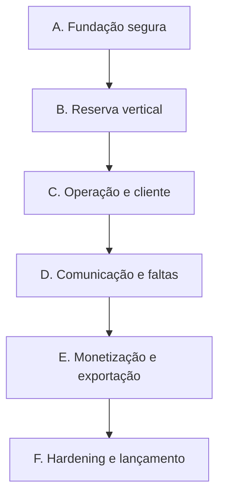

# 06 — Backlog, critérios de aceite e roteiro de entrega

## 1. Como usar este backlog

Este documento transforma a especificação em incrementos demonstráveis. A prioridade indica necessidade para o lançamento:

- **P0:** bloqueia o MVP comercial.
- **P1:** deve entrar antes da abertura ampla ou logo após beta controlado.
- **P2:** evolução pós-MVP.

Tamanhos `S/M/L` são relativos e servem para fatiamento, não como promessa de prazo. A equipe estima após validar UX, provedores e capacidade.

## 2. Sequência recomendada

Cada incremento termina com demonstração funcional, métricas básicas e testes automatizados. Evitar implementar todas as camadas horizontais antes de provar uma reserva ponta a ponta.

## 3. Incremento A — Fundação segura

### AGD-001 — Estrutura modular e pipeline

**Prioridade:** P0 · **Tamanho:** M

Entregar backend Java/Spring, frontend TypeScript/React, migrações, ambientes locais e CI.

Critérios de aceite:

- Projeto compila e testes executam em pipeline limpo.
- PostgreSQL real é usado nos testes de integração via container.
- ArchUnit impede dependências proibidas entre módulos.
- Imagens são identificadas por digest e não contêm segredos.
- Uma migração nova pode ser aplicada do zero e sobre a versão anterior.

### AGD-002 — Tenant e isolamento

**Prioridade:** P0 · **Tamanho:** L

Critérios de aceite:

- Tenant possui ID, nome, slug único, fuso IANA e status.
- Tenant autenticado é derivado no servidor.
- Todas as tabelas de negócio exigem `tenant_id`.
- Testes tentam ler/mutar IDs de outro tenant e recebem resposta não reveladora.
- Slugs concorrentes não são duplicados.

### AGD-003 — Autenticação e autorização administrativa

**Prioridade:** P0 · **Tamanho:** M

Critérios de aceite:

- Administrador faz login e encerra sessão por mecanismo seguro.
- Rotas administrativas rejeitam usuário público/cliente.
- Sessões expiram e podem ser revogadas.
- Ações privilegiadas exigem papel apropriado.
- Falhas e logins relevantes geram evento de segurança sem registrar credenciais.

### AGD-004 — Auditoria e correlação

**Prioridade:** P0 · **Tamanho:** M

Critérios de aceite:

- Toda mutação administrativa crítica registra ator, ação, alvo, resultado, instante e correlation ID.
- Logs e respostas carregam `traceId`.
- Telefone, códigos e tokens são redigidos.
- Auditoria é append-only para a aplicação comum.
- Uma falha transacional não deixa auditoria afirmando efeito que não ocorreu.

### AGD-005 — Idempotência e outbox reutilizáveis

**Prioridade:** P0 · **Tamanho:** L

Critérios de aceite:

- Registro vincula chave, tenant, escopo e digest.
- Mesma chave/payload devolve resultado original.
- Mesma chave/payload divergente retorna `IDEMPOTENCY_KEY_REUSED`.
- Mutação de domínio e outbox são atômicas.
- Worker recupera item após crash e consumidores toleram duplicação.

## 4. Incremento B — Reserva vertical ponta a ponta

### AGD-010 — Catálogo de serviços

**Prioridade:** P0 · **Tamanho:** M

Critérios de aceite:

- Administrador cria, edita, ativa e inativa serviço.
- Duração é positiva e múltipla de 15 minutos. Buffer posterior aceita zero ou valores positivos múltiplos de 15 minutos (decisão de produto aprovada em 15/10/2026).
- Serviço inativo some do público sem alterar reservas existentes.
- Reserva futura preserva snapshot do serviço confirmado.

### AGD-011 — Grade semanal e políticas

**Prioridade:** P0 · **Tamanho:** L

Critérios de aceite:

- Administrador define múltiplos períodos por dia sem sobreposição.
- Limites locais usam múltiplos de 15 minutos, intervalos `[início,fim)`, adjacência permitida, sobreposição rejeitada, início anterior ao fim e cruzamento de meia-noite rejeitado no MVP; o alinhamento independe do slot de 30/60 minutos.
- Configura slot 15/30/60, antecedência 1–24 h, horizonte 7/30/60/90 dias, cancelamento 2–24 h e lembrete 2/6/12/24 h.
- Atualização usa versão/CAS.
- Grade inválida é rejeitada sem mudança parcial.
- Fuso do tenant orienta todas as datas locais.

### AGD-012 — Exceções e bloqueios

**Prioridade:** P0 · **Tamanho:** M

Critérios de aceite:

- Data pode ser fechada ou receber horário especial.
- Administrador cria e remove bloqueio com motivo.
- Bloqueio sobre reserva existente é recusado ou exige fluxo explícito de resolução; não oculta o conflito.
- Mudanças invalidam cache de disponibilidade.
- Histórico/auditoria preserva quem alterou.
- Horário especial substitui a grade semanal com uma lista final de períodos; ausência de exceção preserva a grade e exceção fechada fecha a data. Remover exceção restaura a grade semanal.
- Horários especiais seguem limites locais de 15 minutos, `[início,fim)`, adjacência permitida, overlap rejeitado e sem cruzar meia-noite.
- Bloqueios são semiabertos, podem cruzar datas e mudanças de offset; limites locais inexistentes/ambíguos sem offset são rejeitados, offsets explícitos são validados contra o timezone IANA do tenant, e UTC + zona são persistidos.
- Criar/cancelar bloqueio exige motivo; cancelamento é lógico e preserva identidade, versão e histórico. Não cancelar nem mover reserva automaticamente.
- A integração/concorrência com reservas e invalidação de cache só é concluída quando houver as respectivas infraestruturas; testes com adapters de teste não substituem a evidência integrada.

### AGD-013 — Motor de disponibilidade

**Prioridade:** P0 · **Tamanho:** L

Critérios de aceite:

- Candidatos respeitam grade, exceção, bloqueio, reserva, duração, buffer, antecedência e horizonte.
- Intervalos usam `[início, fim)` e slots adjacentes são permitidos.
- Um serviço só é oferecido se sua ocupação completa couber.
- Horário local inexistente por DST não é oferecido.
- Resultado informa timezone e não promete reserva temporária.
- Testes de propriedade cobrem intervalos e limites.

### AGD-014 — Página pública

**Prioridade:** P0 · **Tamanho:** M

Critérios de aceite:

- Link por slug mostra negócio e serviços ativos.
- Estado inicial é despublicado; somente administrador autenticado pode solicitar publicação/despublicação, com prontidão revalidada em cada leitura. `Tenant.ACTIVE` isoladamente não libera acesso.
- Cliente escolhe serviço, data e slot em celular e desktop.
- Estados de vazio, tenant suspenso e erro são compreensíveis.
- Página não expõe dados internos ou de clientes.
- Telemetria mede visualização, seleção e abandono sem coletar PII desnecessária.
- Se textos/versões legais, evidências de consentimento ou gate comercial requerido não estiverem aprovados e persistidos, a publicação real permanece bloqueada e o administrador recebe os bloqueios; fixtures de teste não representam prontidão real.

### AGD-015 — Commit de reserva sem sobreposição

**Prioridade:** P0 · **Tamanho:** L

Critérios de aceite:

- Nome, telefone E.164 e horário são validados.
- Reserva, cliente, história, auditoria, idempotência e outbox confirmam juntos.
- Constraint PostgreSQL impede sobreposição.
- Duas requisições concorrentes no mesmo slot geram exatamente uma reserva confirmada.
- Perdedora recebe `SLOT_NO_LONGER_AVAILABLE`.
- WhatsApp indisponível não desfaz reserva.

### AGD-016 — Retry seguro do frontend

**Prioridade:** P0 · **Tamanho:** S

Critérios de aceite:

- Frontend gera uma chave por intenção e a preserva após timeout.
- Clique duplo não duplica reserva.
- Timeout seguido de retry retorna o compromisso original quando confirmado.
- Reutilização incompatível não é ocultada.
- Operação em andamento possui estado consultável ou mensagem segura para aguardar.
- A identidade e o vínculo de recuperação existem antes do envio que pode confirmar a reserva; perda da resposta do preparo não autoriza envio confirmador.
- Reload recupera a mesma intenção sem PII no browser storage, URL, histórico ou telemetria; campos pessoais são reintroduzidos e validados contra o digest original.
- Consulta da intenção é read-only, tenant-scoped e devolve somente estado/receipt mínimo; não é acesso autenticado do cliente nem consulta por telefone.
- Estado sem receipt é incerto e nunca libera nova chave automaticamente; operação concorrente, timeout e falha da consulta mantêm ação segura.
- Múltiplas abas/cliques da mesma intenção reutilizam chave/capability e produzem uma reserva, história, auditoria e evento lógico.
- Digest de novos comandos públicos usa HMAC-SHA-256 e canonicalização versionada com keyId; configuração/keyring estáveis são obrigatórios, rotação mantém chaves históricas, e chave necessária ausente falha de modo seguro.
- Digests legados SHA-256 permanecem replayáveis sem reescrever registros; teste prova compatibilidade. Segredos HMAC não aparecem em banco, logs, browser ou código de produção.

## 5. Incremento C — Operação administrativa e cliente

### AGD-020 — Agenda diária/semanal

**Prioridade:** P0 · **Tamanho:** L

Critérios de aceite:

- Administrador consulta período com filtros por status/serviço.
- Visualização usa timezone do tenant e distingue serviço, buffer e bloqueio.
- Paginação/limite evita consulta ilimitada.
- Abertura de detalhes mostra história relevante.
- Atualização concorrente não é sobrescrita silenciosamente.

### AGD-021 — Reserva administrativa e encaixe

**Prioridade:** P0 · **Tamanho:** M

Critérios de aceite:

- Administrador cria reserva para cliente existente ou novo.
- Pode ignorar grade/antecedência explicitamente, com motivo.
- `OUTSIDE_WEEKLY_SCHEDULE` ignora somente a grade semanal quando não há exceção na data; `CLOSED` permanece fechado e `SPECIAL` restringe a ocupação completa, incluindo buffer, aos períodos finais. `MIN_NOTICE` pode ser ignorada independentemente, inclusive em período `SPECIAL`.
- Não pode ignorar sobreposição.
- Pode reservar para cliente bloqueado, com auditoria.
- UI lista as políticas excepcionalmente ignoradas.

### AGD-022 — Remarcação atômica

**Prioridade:** P0 · **Tamanho:** L

Critérios de aceite:

- Apenas reserva confirmada pode ser remarcada.
- Novo intervalo é validado e trocado na mesma transação.
- Em conflito, o intervalo antigo permanece.
- Versão é incrementada e história registra antes/depois.
- Lembrete antigo é invalidado e nova notificação é solicitada.

**Nota de evidência atual:** a branch AGD-031 implementa intents persistidas versionadas, invalidação da versão anterior e nova intent após `AppointmentRescheduled`, com dedupe PostgreSQL; essa prova local ainda não está integrada à main. A ausência de entrega real por fornecedor continua explícita e não é provada por registrar intent.

### AGD-023 — Cancelamento e encerramento

**Prioridade:** P0 · **Tamanho:** M

Critérios de aceite:

- Cliente cancela somente dentro da política.
- Administrador cancela, conclui ou marca falta por comandos separados.
- Transições terminais inválidas são rejeitadas.
- Retry do mesmo comando é idempotente.
- Cancelamento libera ocupação apenas após commit.

**Decisão de produto aprovada pelo usuário em 17/10/2026 e registrada na ADR-0018:** `COMPLETED` e `NO_SHOW` exigem instante atual igual ou posterior a `occupiedUntil`, incluindo buffer; cancelamento do cliente aceita igualdade em `startsAt - cancellationCutoffHours`; cancelamento administrativo não herda o cutoff do cliente. Sem tolerância de dez minutos. O domínio calcula a política do cliente, mas a rota mutável depende de identidade verificada AGD-024/025. Cancelamento administrativo não exige serviço ativo.

### AGD-024 — Código de acesso por WhatsApp

**Prioridade:** P0 · **Tamanho:** L

Critérios de aceite:

- Código expira em cinco minutos e é armazenado como hash.
- Resposta de solicitação não enumera telefones.
- Limite de três envios/15 min e bloqueio de 30 min funcionam atomicamente.
- Cinco erros bloqueiam o desafio por cinco minutos.
- Código validado/expirado não pode ser reutilizado.
- Falha do provedor é observável e não revela segredo.

### AGD-025 — Área do cliente

**Prioridade:** P0 · **Tamanho:** M

Critérios de aceite:

- Sessão limita acesso ao tenant + telefone verificados.
- Cliente lista e consulta apenas suas reservas.
- Cliente bloqueado continua consultando e cancelando.
- Cancelamento fora do prazo orienta contato sem realizar efeito.
- Logout e expiração encerram acesso.

## 6. Incremento D — Comunicação e faltas

### AGD-030 — Pipeline de notificações

**Prioridade:** P0 · **Tamanho:** L

Critérios de aceite:

- Confirmação, remarcação e cancelamento criam intenções deduplicadas.
- Worker classifica falha recuperável, definitiva e ambígua.
- Retry usa backoff e limite.
- Webhook do provedor é autenticado e deduplicado.
- Estado de entrega não altera indevidamente o estado da reserva.

### AGD-031 — Lembrete único

**Prioridade:** P0 · **Tamanho:** M

Critérios de aceite:

- Horário é calculado conforme offset configurado.
- Job atrasado reavalia se ainda faz sentido enviar.
- Reserva cancelada, encerrada ou remarcada não recebe lembrete obsoleto.
- Dois workers não produzem dois efeitos lógicos.
- Backlog e idade do lembrete são monitorados.

**Nota de escopo/evidência:** falta de fornecedor e template aprovados não autoriza envio real; o núcleo persistido pode ser comprovado por Testcontainers e adapters controlados. Decisão de produto aprovada nesta instrução para AGD-031: ausência de política não cria lembrete nem inventa offset; job atrasado pode ser enviado somente enquanto a reserva estiver `CONFIRMED`, na versão atual, e com início estritamente futuro; reserva cujo evento é consumido após `due_at` fica imediatamente elegível se ainda futura; offset é materializado no consumo e mudanças posteriores não recalculam intenções existentes, enquanto eventos ainda não consumidos usam a política vigente no processamento. Detalhes em ADR-0021 e contrato.

Os testes locais de AGD-031 comprovam invalidação em estado terminal; os testes de AGD-030 cobrem separadamente a intent de notificação de cancelamento. A composição E2E-05 com fornecedor, mensagem entregue, cancelamento de mensagem já em voo ou exatamente-uma-vez externo não está comprovada.

### AGD-032 — Faltas em janela móvel

**Prioridade:** P0 · **Tamanho:** M

Critérios de aceite:

- Falta confirmada entra na contagem de 12 meses.
- Cancelamento/conclusão não conta.
- Limite por tenant aceita valores de 1 a 5.
- Correção de falta reavalia a restrição.
- Eventos usados na contagem são explicáveis na área administrativa.

**Decisões aprovadas pelo usuário em 19/10/2026 (ADR-0023):** a avaliação captura `asOf` uma vez; usa 12 meses de calendário UTC e intervalo `[windowStart, asOf)`, com ajuste de data impossível ao último dia válido; conta pelo instante original do evento de `NO_SHOW`, timezone do tenant somente para exibição. Correção administrativa é exclusivamente `NO_SHOW → COMPLETED`, com motivo, autorização, CAS/idempotência e história compensatória referenciada; não apaga o fato nem retorna a `CONFIRMED`. Política ausente é `NOT_CONFIGURED`, sem default, contagem/fatos consultáveis e sem inferir `CLEAR`/bloqueio. O status legado `NOT_TRACKED` não é emitido após AGD-033 e é preservado apenas em detalhes históricos de auditoria.

### AGD-033 — Bloqueio e desbloqueio de autoagendamento

**Prioridade:** P0 · **Tamanho:** M

Critérios de aceite:

- Ao atingir limite, restrição ativa é criada sem corrida.
- Fluxo público bloqueia antes do commit e mostra mensagem neutra.
- Administrador consegue reservar e desbloquear com motivo.
- Desbloqueio não apaga faltas.
- Nova falta pode reativar bloqueio conforme política atual.

O fluxo público consulta a restrição tenant-scoped no servidor sob o mesmo lock por tenant usado na confirmação, antes de gravar cliente/reserva. A rejeição é neutra e não revela contagem/fatos. Reserva administrativa continua permitida; consulta e cancelamento do cliente não são bloqueados. Política ausente é `NOT_CONFIGURED`, não `CLEAR`. Decisões aprovadas pelo usuário em 20/10/2026 (ADR-0024): correção/envelhecimento não liberam restrição ativa; política ausente preserva bloqueios e não cria novos; sem política e sem restrição, novas reservas públicas são permitidas sob os demais gates; redução de limite exige reconciliação administrativa explícita, após o PUT, tenant-scoped, versionada e idempotente. A reconciliação não reutiliza falta já consumida como causa.

AGD-033 materializa uma restrição quando uma nova transição de `NO_SHOW` atinge a política configurada, consulta-a na confirmação pública sob lock tenant-scoped, oferece desbloqueio explícito e reconciliação administrativa versionada por cliente. Correção/envelhecimento atualizam a contagem sem remover restrição. Política ausente não libera uma restrição existente nem ativa outra; sem política e sem restrição, a reserva pública segue permitida sem inferir `CLEAR`, mantendo os gates gerais. Reconciliação avalia fatos numa única janela/asOf, usa somente causa ainda não consumida, possui CAS da política e idempotência, e não é executada implicitamente no PUT. A consulta/cancelamento do cliente e reserva administrativa permanecem permitidos.

## 7. Incremento E — Monetização e exportação

### AGD-040 — Trial e planos

**Prioridade:** P0 · **Tamanho:** L

Critérios de aceite:

- Novo tenant elegível inicia trial de 14 dias sem cartão.
- Planos mensal e anual são apresentados; anual equivale a 10 mensalidades.
- Trial não é concedido novamente por simples recriação.
- Datas e status são visíveis ao administrador.
- Fim do trial sem contratação fecha novas reservas conforme estado definido.

O provisionamento real exige identidade comercial estável, opaca e verificada por fonte confiável do servidor. Não derivar identidade de tenant, slug, e-mail, subject OIDC ou declaração do navegador. Enquanto essa fonte não estiver aprovada/configurada, não conceder trial em produção; adapters sintéticos são restritos a testes/E2E. A validade termina em `now >= trialEndsAt` e o gate do servidor bloqueia imediatamente novas reservas, mesmo que a materialização `TRIALING → SUSPENDED` esteja pendente. O anual é apresentado como dez mensalidades sem preço/moeda inventados; trial/plano não equivale a pagamento nem substitui os gates legais/comerciais de publicação.

### AGD-041 — Checkout e webhook financeiro

**Prioridade:** P0 · **Tamanho:** L

Critérios de aceite:

- Dados completos de cartão não atravessam/ficam na plataforma.
- Webhook inválido não altera assinatura.
- Evento repetido produz um único efeito lógico.
- Evento fora de ordem não reverte fato mais novo.
- Pagamento é confirmado por evidência do provedor, não pelo frontend.

### AGD-042 — Inadimplência, retries e suspensão

**Prioridade:** P0 · **Tamanho:** L

Critérios de aceite:

- Vencimento inicia `PAST_DUE` e tolerância de sete dias.
- Tentativas lógicas ocorrem em D0, D+3 e D+6, sem duplicação.
- Pagamento confirmado cancela retries pendentes.
- Sem confirmação até o fim, assinatura passa a `SUSPENDED` por CAS.
- Link público não aceita nova reserva; dados e reservas existentes permanecem.

O ciclo de inadimplência não acrescenta sete dias ao trial de AGD-040. A API administrativa apresenta vencimento, início/fim da tolerância e tentativas minimizadas; agendamento, claim e aceite do transporte não equivalem a pagamento. **Decisão aprovada pelo usuário em 22/10/2026:** tolerância termina em `now >= graceEndsAt`, exatamente 168 horas após vencimento; D0/D+3/D+6 são offsets UTC de 0/72/144 horas. Em recuperação tardia durante a tolerância, somente a tentativa vencida mais recente nunca iniciada pode permanecer elegível; as anteriores nunca iniciadas são `SKIPPED_LATE_RECOVERY` com motivo, sem mover futuras ou criar novas. Tentativas iniciadas/em voo/ambíguas não são puladas e bloqueiam outra cobrança lógica até reconciliação. Após o fim da tolerância não se inicia chamada nova, mas resultados previamente iniciados são preservados inclusive após suspensão. Isso não amplia o trial. Provider, oferta, preço/moeda, autorização recorrente real, segredos e homologação permanecem pendentes e o transporte segue fail-closed.

### AGD-043 — Reativação e renovação

**Prioridade:** P0 · **Tamanho:** M

Critérios de aceite:

- Pagamento confirmado reativa imediatamente o tenant.
- Retry de reativação não duplica efeito.
- Mensal renova automaticamente conforme autorização vigente.
- Anual avisa sete dias antes e exige autorização.
- Resultado ambíguo de cobrança fica reconciliando; não cria cobrança paralela com nova identidade.

AGD-043 reutiliza as tentativas periódicas de AGD-042 como autoridade única. O caminho de pagamento renovado exige evento autenticado, correlacionado ao attempt e compatível com seus termos persistidos; dedupe/replay não repetem reativação. A autorização para mensal é revalidada no início da tentativa; anual exige autorização específica do período, distinta do mandato mensal. Aviso anual usa uma intenção lógica tenant/assinatura/período e é invalidado por mudança de período. Sem transport/verificador real, testes sintéticos demonstram somente composição. Âncora/duração do período e pagamentos antecipados/atrasados seguem pendentes até definição comercial e contrato com autoridade financeira.

### AGD-044 — Exportação CSV e PDF

**Prioridade:** P0 · **Tamanho:** L

Critérios de aceite:

- Categorias e filtros definidos geram snapshot imutável.
- Apenas um job ativo por tenant.
- Retentativas ocorrem em 30 s, 1 min e 2 min.
- Arquivo disponível por 30 minutos e depois não pode ser servido.
- Conteúdo pertence somente ao tenant solicitante.
- Auditoria registra solicitação, disponibilidade e download.

### AGD-045 — Download excepcional com dupla aprovação

**Prioridade:** P1 · **Tamanho:** M

Critérios de aceite:

- Operação exige dois aprovadores elegíveis e independentes.
- Capability/link é de uso único e expira em 15 minutos.
- Versão do arquivo, autorização e tenant são revalidados no consumo.
- Alteração/revogação torna capability obsoleta.
- Todo acesso excepcional fica auditado por dois anos conforme política.

## 8. Incremento F — Privacidade, operação e lançamento

### AGD-050 — Retenção, exclusão e legal hold

**Prioridade:** P0 · **Tamanho:** L

Critérios de aceite:

- Categorias de dado possuem política e base registradas.
- Cancelamento/suspensão aplica retenção inicial de 12 meses, subordinada a exclusão e hold válido.
- Pedido de exclusão apaga conteúdo sem base remanescente.
- Legal hold preserva somente o mínimo e tem validade/autoridade.
- Auditoria remanescente não contém conteúdo excluído.

### AGD-051 — Backup e restore isolado

**Prioridade:** P0 · **Tamanho:** L

Critérios de aceite:

- Backup automatizado alerta em falha.
- Restore é exercitado em ambiente isolado.
- Ledger/tombstones externos ao backup são reaplicados antes de leituras.
- Sem ledger íntegro/autoritativo, restore permanece selado.
- RPO e RTO observados são registrados.

### AGD-052 — Observabilidade e runbooks

**Prioridade:** P0 · **Tamanho:** L

Critérios de aceite:

- Dashboards cobrem API, reservas, workers, WhatsApp, cobrança e exportação.
- Alertas possuem limiar, responsável e runbook.
- Worker parado/backlog antigo é detectado.
- Falha financeira ambígua abre item de reconciliação.
- Telemetria não vaza PII/segredo.

### AGD-053 — Segurança de aplicação e infraestrutura

**Prioridade:** P0 · **Tamanho:** L

Critérios de aceite:

- TLS, headers, CORS/CSRF, secret manager e privilégio mínimo estão configurados.
- Dependency/SAST/container scans rodam no CI.
- Teste de autorização cobre IDOR e cruzamento de tenant.
- Rate limit cobre código de acesso, login e webhooks abusivos.
- Ações de suporte exigem autenticação forte e são auditadas.

### AGD-054 — Testes de carga e concorrência

**Prioridade:** P0 · **Tamanho:** M

Critérios de aceite:

- Carga representativa mede p95 da disponibilidade e commit.
- Disputa intensa pelo mesmo slot confirma somente uma reserva.
- Múltiplos tenants não causam vazamento nem starvation indevido.
- Workers respeitam limites do provedor.
- Plano de capacidade e gargalos conhecidos são documentados.

### AGD-055 — Homologação e rollout controlado

**Prioridade:** P0 · **Tamanho:** M

Critérios de aceite:

- Smoke test automatizado passa em staging e produção.
- Provedores estão em credenciais/ambiente corretos.
- Termos, privacidade, suporte e políticas comerciais estão publicados.
- Feature flag permite fechar novas reservas sem apagar agenda.
- Beta inicia com tenants controlados e monitoração reforçada.

## 9. Histórias pós-MVP prioritárias

| ID | História | Prioridade |
|---|---|---|
| AGD-100 | múltiplos usuários e papéis por tenant | P1 |
| AGD-101 | remarcação autônoma do cliente | P1 |
| AGD-102 | múltiplos profissionais/recursos | P2 |
| AGD-103 | sincronização de calendário externo | P2 |
| AGD-104 | fila de espera | P2 |
| AGD-105 | pagamentos do atendimento | P2 |
| AGD-106 | capabilities completas para correções críticas | P2 |
| AGD-107 | grafo de evidência/quarentena e cut proofs | P2 |
| AGD-108 | manifests Merkle e reconciliação de grande escala | P2 |

Múltiplos profissionais é mudança significativa: a exclusão de sobreposição passa de tenant para recurso. Deve ser planejada antes de qualquer workaround que permita overlap na agenda única.

## 10. Cenários de aceite ponta a ponta

### E2E-01 — Reserva normal

**Dado** tenant ativo, serviço de 60 min + buffer de 15 min e grade 09:00–18:00  
**Quando** cliente escolhe 10:00 e confirma com dados válidos  
**Então** existe uma reserva `CONFIRMED` ocupando `[10:00,11:15)`, a resposta não espera WhatsApp e uma intenção de confirmação é criada.

### E2E-02 — Corrida pelo mesmo slot

**Dado** slot livre 10:00  
**Quando** dois clientes confirmam concorrentemente  
**Então** exatamente uma transação confirma e a outra recebe `SLOT_NO_LONGER_AVAILABLE`, sem cliente/reserva/outbox órfãos da transação perdedora.

### E2E-03 — Timeout e retry

**Dado** commit confirmado e resposta perdida  
**Quando** o frontend repete com a mesma chave e payload  
**Então** recebe o mesmo `appointmentId`; com payload diferente, recebe conflito de idempotência.

### E2E-04 — Remarcação concorrente

**Dado** administrador leu versão 3  
**Quando** outro comando muda a reserva para versão 4 antes da remarcação  
**Então** a tentativa com versão 3 falha sem alterar intervalo ou notificação.

### E2E-05 — Cancelamento e lembrete

**Dado** lembrete pendente  
**Quando** reserva é cancelada  
**Então** ocupação é liberada, lembrete fica obsoleto e mensagem de cancelamento é solicitada uma única vez.

### E2E-06 — Bloqueio por faltas

**Dado** política de duas faltas e cliente com uma falta na janela  
**Quando** segunda reserva é marcada `NO_SHOW`  
**Então** restrição ativa é criada; reserva pública seguinte é negada, mas acesso e cancelamento continuam disponíveis.

### E2E-07 — Encaixe de cliente bloqueado

**Dado** cliente com restrição ativa e horário fora da grade, sem overlap  
**Quando** administrador cria encaixe com motivo  
**Então** reserva confirma, exceções ficam auditadas e restrição permanece.

### E2E-08 — Código abusado

**Dado** três envios nos últimos 15 min  
**Quando** há nova solicitação  
**Então** o envio é bloqueado por 30 min, a resposta é neutra e a tentativa é monitorada sem revelar existência do telefone.

### E2E-09 — Suspensão e reativação

**Dado** assinatura `PAST_DUE` além de sete dias e nenhum pagamento confirmado  
**Quando** job de suspensão executa  
**Então** tenant fica `SUSPENDED` e novas reservas fecham.  
**Quando** pagamento autêntico é confirmado depois  
**Então** tenant volta a `ACTIVE` sem perder dados.

### E2E-10 — Webhook duplicado/fora de ordem

**Dado** pagamento já confirmado e assinatura ativa  
**Quando** o mesmo webhook chega novamente e depois chega evento antigo de falha  
**Então** não há efeito duplicado e a falha antiga não rebaixa o estado.

### E2E-11 — Exportação

**Dado** filtro por período e status  
**Quando** job conclui  
**Então** arquivo corresponde ao snapshot, digest é registrado, download expira em 30 min e outro tenant nunca o acessa.

### E2E-12 — Restore com exclusão

**Dado** backup anterior a uma exclusão legítima  
**Quando** é restaurado  
**Então** ambiente permanece isolado até reaplicar tombstone; o conteúdo excluído não é liberado.

### E2E-13 — Resultado externo ambíguo

**Dado** timeout após pedido de cobrança sem prova de ausência  
**Quando** worker avalia retry  
**Então** mantém a mesma operação em reconciliação e não cria cobrança lógica nova.

## 11. Matriz mínima de testes não funcionais

| Área | Teste | Gate |
|---|---|---|
| Concorrência | 100+ tentativas simultâneas no mesmo intervalo | uma confirmação, zero overlap |
| Tenant | fuzz de IDs cruzados em rotas | zero leitura/mutação cruzada |
| Idempotência | replay antes/depois de timeout/crash | um efeito lógico |
| Timezone | transições DST e offsets | nenhum slot inválido/ambíguo confirmado |
| Webhook | inválido, duplicado, atrasado, fora de ordem | estado correto e auditável |
| Worker | crash após efeito e antes de ack | replay seguro |
| Exportação | expiração e URL vazada | acesso negado após prazo/sem autorização |
| Backup | restore anterior a tombstone | dado excluído não reaparece |
| Carga | janela comum de disponibilidade | SLO proposto demonstrado ou revisado |
| Segurança | OWASP/IDOR/CSRF/rate limit | achados críticos/altos resolvidos |

## 12. Definition of Ready

Uma história entra em desenvolvimento quando:

- objetivo e ator estão claros;
- critério de aceite é testável;
- dependências e migrações são conhecidas;
- estados de erro/empty/loading foram definidos;
- dados pessoais e auditoria foram avaliados;
- contrato de API está rascunhado quando aplicável;
- feature flag/rollout foram considerados para alto impacto.

## 13. Definition of Done

Uma história só está concluída quando:

- critérios funcionais passaram;
- testes unitários, integração e contrato relevantes passaram;
- isolamento por tenant e autorização foram testados;
- idempotência/concorrência foram tratadas se houver mutação;
- migração é segura e revisada;
- logs, métricas e alertas necessários existem;
- auditoria e privacidade estão adequadas;
- documentação/OpenAPI/runbook foram atualizados;
- staging foi verificado;
- nenhum achado crítico/alto aberto se aplica à entrega.

## 14. Gate final do MVP

Não liberar publicamente enquanto qualquer item abaixo estiver sem evidência:

- [ ] reserva concorrente sem overlap;
- [ ] idempotência de criação, remarcação, cobrança e webhooks;
- [ ] isolamento completo por tenant;
- [ ] fluxo público responsivo e acessível;
- [ ] operações administrativas essenciais;
- [ ] WhatsApp com rate limit, dedupe e monitoramento;
- [ ] faltas e bloqueio sem impedir acesso/cancelamento;
- [ ] trial, tolerância, suspensão e reativação;
- [ ] CSV/PDF com snapshot, expiração e autorização;
- [ ] auditoria e privacidade revisadas;
- [ ] backup restaurado e tombstones validados;
- [ ] dashboards, alertas e runbooks;
- [ ] termos, suporte e provedores prontos;
- [ ] beta controlado concluído sem incidente crítico aberto.

## 15. Decisões de sprint zero

Apenas estas definições precisam ser fechadas para converter o backlog em sprints:

1. provedor de identidade administrativa;
2. provedor de WhatsApp e templates;
3. provedor de cobrança e sandbox;
4. wireframes/copy final;
5. semântica da regra excepcional de dez minutos;
6. SLOs e retenção validados por operação/jurídico;
7. composição da equipe e capacidade, para estimativas.

Com essas decisões, o backlog P0 já pode ser refinado sem nova rodada extensa de elicitação.
